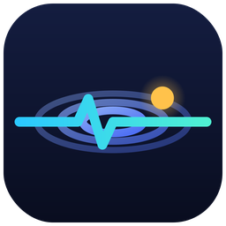

<div align="center">



# GravityWatch for Antigravity

Read-only live status bar and bottom panel for Antigravity session context windows, subagent token rollups, and 5h/weekly quota pools — plus optional multi-account quota monitoring and opt-in account switching.

[](https://marketplace.visualstudio.com/items?itemName=Zahed-r.antigravity-session-monitor)
[](https://github.com/Zahed316/antigravity-session-monitor/blob/main/LICENSE)
[](https://github.com/Zahed316/antigravity-session-monitor/stargazers)

</div>

## Why this exists

Every Antigravity session burns context, and Antigravity gives you no built-in way to watch it fill up. Until now, checking meant manually opening Antigravity's local SQLite databases in a database browser, or relying on generic token counters that know nothing about subagent rollups or quota pools.

GravityWatch is a dedicated viewer for Antigravity internals:

- **Status bar + rich hover** for the active or pinned session: live context window usage, token-volume cache savings, running indicator, and live 5h/weekly quota pools.
- **Subagent rollups**: child subagent token usage, LLM calls, compactions, and running state roll up onto the parent session — while each subagent stays inspectable individually.
- **QuickPick session inspector** with workspace scoping, so you can pin any session to the status bar.
- **Lazy bottom panel** ("Antigravity Monitor") with a quota header, collapsible session tree, detail breakdown, and an inline SVG call-by-call context growth chart — rendered only when opened.
- **Multi-account monitoring**: an **Accounts** tab with saved Accounts, a multi-Account quota matrix (5h/weekly percentages, reset times, and an explicit `Reset passed · stale` badge instead of a misleading 100%), 30-day quota history exports (CSV/JSON), Account metadata backups, and runtime/hub diagnostics.
- **Opt-in Account switching** (off by default until you ask for it): switch the active Antigravity Account using credentials captured locally into VS Code SecretStorage, or the official Antigravity sign-out/sign-in flow. **No Direct Google OAuth** is implemented: GravityWatch never runs its own OAuth loopback flow, never asks for your Google password, and never stores credentials outside the OS-provided secret store.

It is strictly read-only and 100% local: it never patches the host extension, never writes to Antigravity's data, and never sends anything anywhere. The only exceptions are the explicitly opt-in switching actions, which talk to your locally running Antigravity hub (loopback only) using credentials you captured from your own sessions.

## Install

From the VS Code Marketplace, search for **GravityWatch for Antigravity** (publisher `Zahed-r`), or install a packaged VSIX directly:

```sh
code --install-extension antigravity-session-monitor-0.1.9.vsix
```

Requires VS Code 1.99+.

## Commands

All commands live under the **Antigravity Monitor** category and are available from the Command Palette.

| Command ID | Title |
| --- | --- |
| `antigravityMonitor.openQuickPick` | Select or Pin Session |
| `antigravityMonitor.openPanel` | Open Bottom Panel |
| `antigravityMonitor.pinSession` | Pin Session to Status Bar |
| `antigravityMonitor.unpinSession` | Unpin Session (Auto-Track) |
| `antigravityMonitor.toggleScope` | Toggle Workspace Scope |
| `antigravityMonitor.refresh` | Refresh Telemetry |
| `antigravityMonitor.switchAccount` | Switch / Manage Accounts |
| `antigravityMonitor.saveCurrentAccount` | Save Current Account to Vault |
| `antigravityMonitor.addAccount` | Add Account (Official Sign-in) |
| `antigravityMonitor.editAccountLabel` | Edit Account Label |
| `antigravityMonitor.removeSavedAccount` | Remove Saved Account |
| `antigravityMonitor.exportAccounts` | Export Accounts (Metadata Backup) |
| `antigravityMonitor.importAccounts` | Import Accounts (Metadata Backup) |
| `antigravityMonitor.exportQuotaAnalytics` | Export 30-Day Quota Analytics |
| `antigravityMonitor.reconnectHub` | Reconnect Hub |
| `antigravityMonitor.restartBackend` | Restart Antigravity Backend |
| `antigravityMonitor.inspectBridge` | Inspect Bridge |
| `antigravityMonitor.clearTokenVault` | Clear Token Vault |

## Settings

| Setting | Type | Default | Description |
| --- | --- | --- | --- |
| `antigravityMonitor.refreshIntervalMs` | number | `10000` | Telemetry and quota refresh interval in milliseconds while VS Code is focused. |
| `antigravityMonitor.unfocusedRefreshIntervalMs` | number | `30000` | Telemetry and quota refresh interval in milliseconds while VS Code is unfocused. |
| `antigravityMonitor.quotaRefreshIntervalMs` | number | `30000` | Interval (ms) for polling quota and model usage from the local Antigravity hub (minimum 5000ms). Decoupled from local session telemetry polling. |
| `antigravityMonitor.quotaUnfocusedMultiplier` | number | `2` | Multiplier applied to `quotaRefreshIntervalMs` while VS Code is unfocused (e.g., 2 = 2x slower; 0 pauses quota polling while unfocused). |
| `antigravityMonitor.autoFollowActiveSession` | boolean | `true` | Automatically switch the Details tab to follow the active Antigravity conversation when switching conversations. |
| `antigravityMonitor.contextWarningPct` | number | `75` | Context window usage percentage threshold for warning Status Bar highlight. |
| `antigravityMonitor.contextCriticalPct` | number | `90` | Context window usage percentage threshold for critical Status Bar highlight. |
| `antigravityMonitor.defaultScope` | string (`"current"` \| `"all"`) | `"current"` | Default session scope in QuickPick and the Bottom Panel. |
| `antigravityMonitor.dataRootOverride` | string | `""` | Optional override directory for Antigravity local data (defaults to `~/.gemini/antigravity`). |
| `antigravityMonitor.enableLowQuotaAlerts` | boolean | `true` | Show low-quota and exhausted-pool alerts for the active Account's quota pools. |
| `antigravityMonitor.lowQuotaThresholdPct` | number | `20` | Remaining-percent threshold below which a low-quota alert fires (5–50). |
| `antigravityMonitor.notifyQuotaReset` | boolean | `true` | Notify when a flagged low-quota or exhausted window resets. |
| `antigravityMonitor.quotaAlertBackground` | boolean | `true` | Tint the Status Bar quota badge warning/error while any pool is at or below the low-quota threshold. |
| `antigravityMonitor.autoCaptureVault` | boolean | `true` | Automatically capture the active Account credential into the encrypted vault (SecretStorage) when a new Account email is observed. |

## Privacy: how it works

- **Reads Antigravity's local SQLite databases read-only** (SQL `?mode=ro` / `immutable` connections, via `node:sqlite` with an async `sqlite3`/`python3` fallback). Nothing is ever written back.
- **Queries the local Antigravity hub**: quota and model usage come from Connect-RPC calls to your locally running `agy --hub` endpoint, auto-discovered on your machine.
- **Nothing leaves your machine.** GravityWatch collects no telemetry, makes no network calls of its own, and has no accounts or analytics.
- **Account switching is strictly opt-in and local.** Switching uses credentials captured from your own Antigravity sessions into VS Code's `SecretStorage` (OS keyring), or the official Antigravity sign-in flow via the local loopback hub. GravityWatch implements **no Direct Google OAuth**: no OAuth loopback server, no direct Google token exchange, no credential material outside the OS-provided secret store. Account metadata backups contain identities and labels only — never tokens.

## Status

**0.1.9 — experimental.** One maintainer, early days. Antigravity's data layouts are undocumented and may change between its releases, which can break parsing until GravityWatch catches up. File an issue if it does.

## Trademark

Not affiliated with or endorsed by Google. Antigravity is a product of Google.

## License

[MIT](LICENSE)
